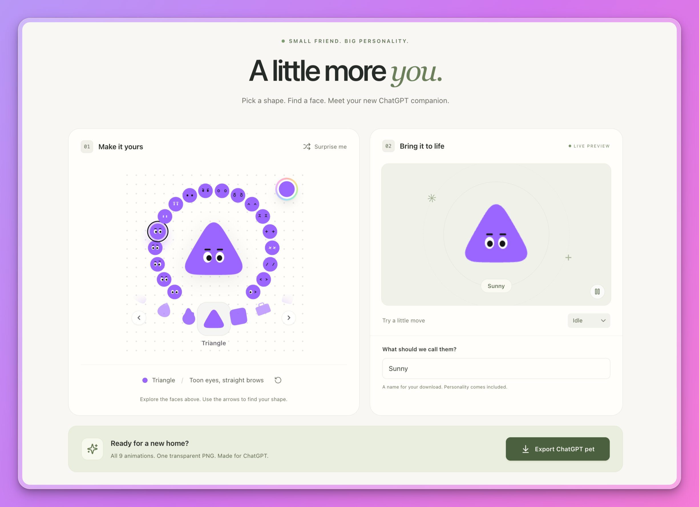

# Alpha Bro Pets



A standalone Vite + React + TypeScript app that extracts Raft’s project avatar
selector and turns the selected avatar into a downloadable ChatGPT pet sprite sheet.
Everything renders locally in the browser. No API key, backend, or Raft installation
is required after setup.

## Run

Use Node 22.12+ (the included `.nvmrc` selects Node 24.21.0).

```sh
nvm use
npm install --include=dev
npm run dev
```

Open the **Local** URL printed by Vite (normally **http://localhost:3000**).
If another task uses that port, Vite selects the next available port and Alpha Bro
detects it from the startup log. The server binds to `localhost`, matching Alpha
Bro's preview URL and detecting conflicts with other localhost dev servers.
For production:

```sh
npm run build
npm run preview
```

`dist/` can be hosted on any static web host. `npm test` runs the animation contract tests.

## Create and export

1. Pick an expression from the ring, a shape from the carousel, and a palette or custom color.
   Arrow keys and Home/End work in the expression and shape groups.
2. Name your pet and preview its nine animation states. The pause control freezes motion.
3. Choose **GIF** beside the motion picker to download the selected move as a
   transparent, endlessly looping **192 × 208 GIF at 50 fps**, using the same smooth
   motion as the preview. GIF supports on/off transparency, so partially transparent
   edge pixels are thresholded. Export runs locally and shows progress.
4. Choose **Export ChatGPT pet** to download a transparent PNG with all animation frames.
5. In ChatGPT, open **Settings → Personalization → Pet → Select pet → Upload pet**
   and choose the PNG. Pet availability depends on your app and account.

Your avatar and name are saved in this browser. Export works without network requests;
fonts, shapes, and artwork are bundled locally. An empty name receives a safe default filename.

### Glass pets

Choose **Glass** beside 2D, 3D, and Furry for tinted, refractive glass with
chromatic dispersion and soft studio reflections. All shapes, faces, nine moves,
orbit controls, PNG sprite sheets, and GIF exports work in Glass mode. Shared
links preserve it with `mode=glass`; downloaded files use a `-glass` suffix.
GIF's on/off alpha cannot retain all of the PNG's translucent detail.
The **Backdrop** control cycles through Grid, Stripes, and Plain in the Glass
preview. Patterns sit behind the pet in the 3D scene so they refract through its
body, and are excluded from transparent exports. The face renders after the
glass to prevent duplicate refracted eyes and brows.
Glass bodies have fully curved, inflated fronts and backs: Round becomes a ball,
while other pets retain their outline around the equator. Facial features follow
the curved surface during animation. Preview and exports use the same geometry.

The glass adapter in `src/pet/3d/petGlass.ts` reuses the clear preset and analytical
studio-light GLSL from [oscarqht/glass](https://github.com/oscarqht/glass), pinned to
commit `f10dc9cd915fb1ee190690591141e196c7471a59`. It adapts those optics to Three.js
mesh transmission and a locally generated reflection environment, rather than
using FluidGlass's standalone seven-shape SDF renderer. This preserves the
existing pet silhouettes and shares the same material and lighting with exports.

The default export is the publicly documented **1536 × 1872** sprite sheet,
with **192 × 208** cells and **57** animation frames. See
[the format notes](docs/pet-format.md) and [OpenAI’s guide](https://learn.chatgpt.com/docs/pets).
Actual acceptance in an authenticated ChatGPT account has not been tested.

## Source

The selector, SVG renderer, shapes, expressions, colors, and icon ID format were
extracted from the sibling Raft project:

- `raft/client/src/components/ProjectIconPicker.tsx`
- `raft/client/src/components/ProjectIconPicker.css`
- `raft/client/src/components/ProjectIcon.tsx`
- `raft/client/src/utils/projectIcons.ts`

This app retains their vector geometry and component API. Large source files were
split into shape definitions, types, and color wheel modules. Extraction adds
keyboard navigation and keeps the color wheel within the standalone card.
The original shape definitions credit [dots-lab](https://dots-lab.pages.dev/).
Raft itself is unchanged. Pet motion and the app shell are new.

## Structure

- `src/components/` — extracted picker and original SVG renderer
- `src/utils/` — shape geometry, expressions, palettes, icon IDs
- `src/pet/` — shared native-cell renderer for preview and PNG export
- `tests/` — timing and frame layout checks
- `docs/` — export format and compatibility notes
